<!-- ░░░ HEADER ░░░ -->

  

  

  

    
    
    
  

<!-- ░░░ HERO TERMINAL ░░░ -->

  

## `>_ about_me.spec.ts`

I sit where **quality, automation and AI** meet. I design test strategy, automate it end to end, wire AI agents into real workflows, and when it matters I deploy forward, embedded with the client until it ships. Most of my work runs on **government and enterprise platforms**, where "it works on my machine" is not an acceptable release note.

  

<b>🔭 &nbsp;Focus areas & what to ask me about</b>

 

| | |
|---|---|
| 🧪 **Agentic QA** | AI agents that read requirements, generate tests, run them and triage the failures |
| 🎭 **E2E at scale** | Playwright and Cypress suites with page objects, fixtures, data-driven runs, CI sharding |
| 🔌 **MCP & LLM tooling** | Connecting models to real systems with Claude, OpenAI, LangGraph and the Model Context Protocol |
| 🛰️ **Forward deployment** | Embedding with client teams, turning messy requirements into shipped, tested software |
| 📡 **IoT + ML** | Sensors → MQTT → models on the edge with Raspberry Pi, Arduino and TensorFlow |

💬 Ask me about **test strategy, Playwright, AI agents, MCP, or bringing AI into a QA team.**

## `>_ cat ~/.quality-pipeline`

  

## `>_ ls ~/stack`

<table>
  <tr>
    <td width="170" valign="middle"><b>🧪 QA & Automation</b></td>
    <td>
       
      
      
      
      
      
      
      
      
      
    </td>
  </tr>
  <tr>
    <td valign="middle"><b>🤖 AI & Agents</b></td>
    <td>
      
      
      
      
      
      
      
      
      
    </td>
  </tr>
  <tr>
    <td valign="middle"><b>🧠 ML & Data</b></td>
    <td>
       
      
      
      
    </td>
  </tr>
  <tr>
    <td valign="middle"><b>📡 IoT</b></td>
    <td>
       
      
      
      
      
    </td>
  </tr>
  <tr>
    <td valign="middle"><b>🌐 Full-Stack & Mobile</b></td>
    <td>
      
    </td>
  </tr>
  <tr>
    <td valign="middle"><b>🗄️ Data & DevOps</b></td>
    <td>
      
    </td>
  </tr>
</table>

## `>_ ls ~/projects --featured`

  

## `>_ git log --live`

<table>
  <tr>
    <td width="50%" valign="top">

**⚡ Recent activity** (auto-updated every 6h)

<!--START_SECTION:activity-->
1. 🛠️ Worked on [Louay-El-hajj](https://github.com/Louay-El-hajj/Louay-El-hajj) · Oct 26, 2026
2. 🛠️ Worked on [estests-qa-automation](https://github.com/Louay-El-hajj/estests-qa-automation) · May 26, 2026
3. 🛠️ Worked on [gym](https://github.com/Louay-El-hajj/gym) · Mar 06, 2025
4. 🛠️ Worked on [hackathon-repo](https://github.com/Louay-El-hajj/hackathon-repo) · May 26, 2024
5. 🛠️ Worked on [Sentinel](https://github.com/Louay-El-hajj/Sentinel) · May 20, 2024
6. 🛠️ Worked on [personal-task-manager](https://github.com/Louay-El-hajj/personal-task-manager) · Apr 16, 2024
<!--END_SECTION:activity-->

  </td>
  <td width="50%" valign="top" align="center">
    
  </td>
  </tr>
</table>

<b>📊 Full metrics dashboard</b> (isometric calendar · languages · activity, refreshed daily)

  

  <picture>
    <source media="(prefers-color-scheme: dark)" srcset="https://raw.githubusercontent.com/Louay-El-hajj/Louay-El-hajj/output/snake-dark.svg" />
    <source media="(prefers-color-scheme: light)" srcset="https://raw.githubusercontent.com/Louay-El-hajj/Louay-El-hajj/output/snake-light.svg" />
    
  </picture>

## `>_ ./connect.sh`

  
  
  
  <!-- TODO: add your portfolio / booking link, then uncomment
  
  
  -->

<code>$ exit 0</code> &nbsp;·&nbsp; <i>Ship fast. Break nothing. Automate the rest.</i>

